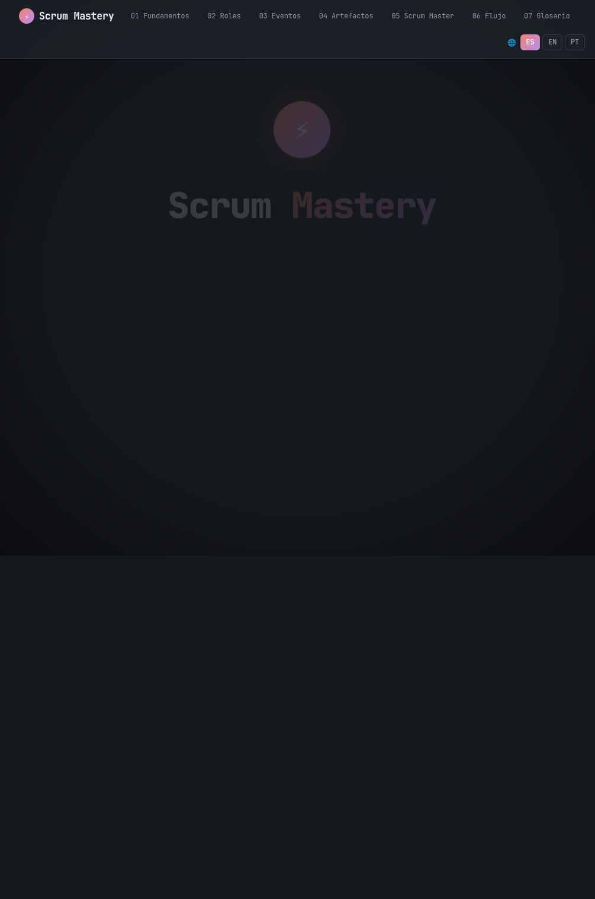

# Scrum Mastery — De Cero a Scrum Master

Curso interactivo de Scrum en formato de diapositivas, de los fundamentos hasta el día a día del Scrum Master.

🔗 **Ver en línea:** https://jdswe.github.io/scrum-mastery/

## Contenido

1. [Fundamentos de Scrum](01-fundamentos.html)
2. [Roles](02-roles.html)
3. [Eventos](03-eventos.html)
4. [Artefactos](04-artefactos.html)
5. [Scrum Master](05-scrum-master.html)
6. [Flujo y Métricas](06-flujo-metricas.html)
7. [Glosario de Scrum](07-glosario.html)

## Tecnologías

HTML, CSS y JavaScript sin dependencias ni build. Solo abre `index.html` o visita el sitio publicado en GitHub Pages.
